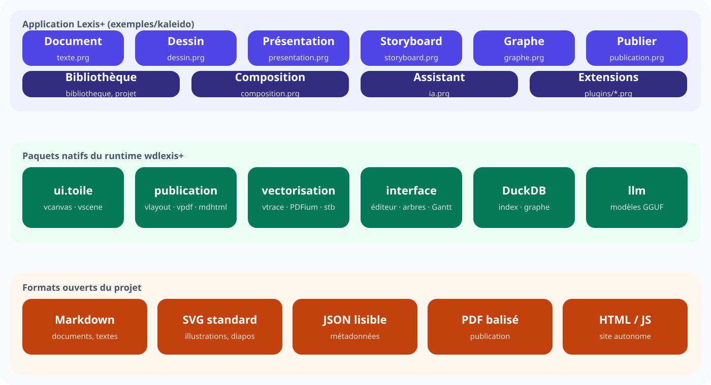
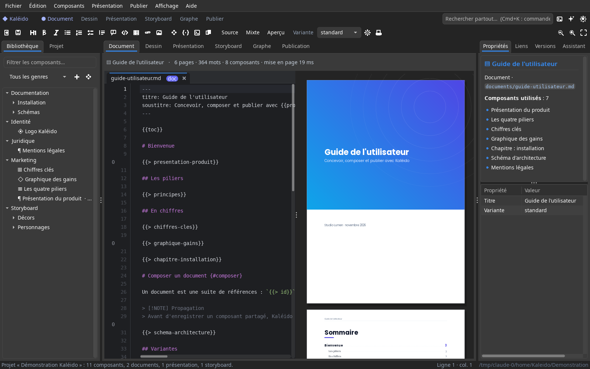
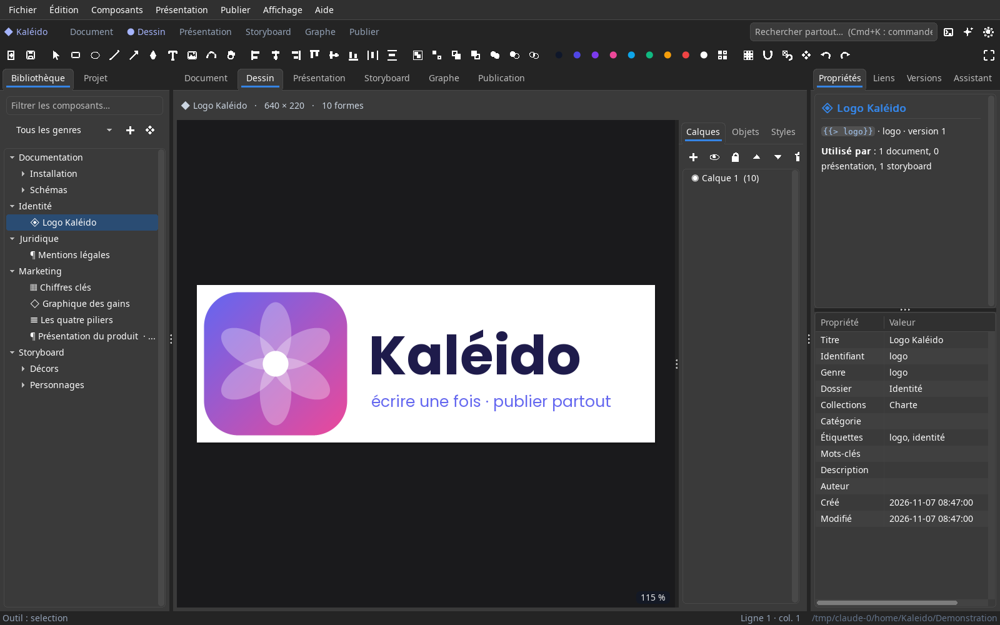
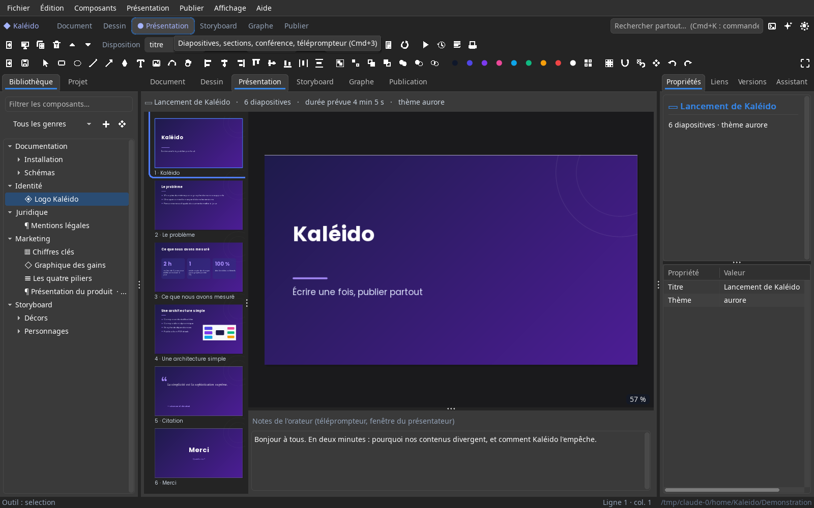
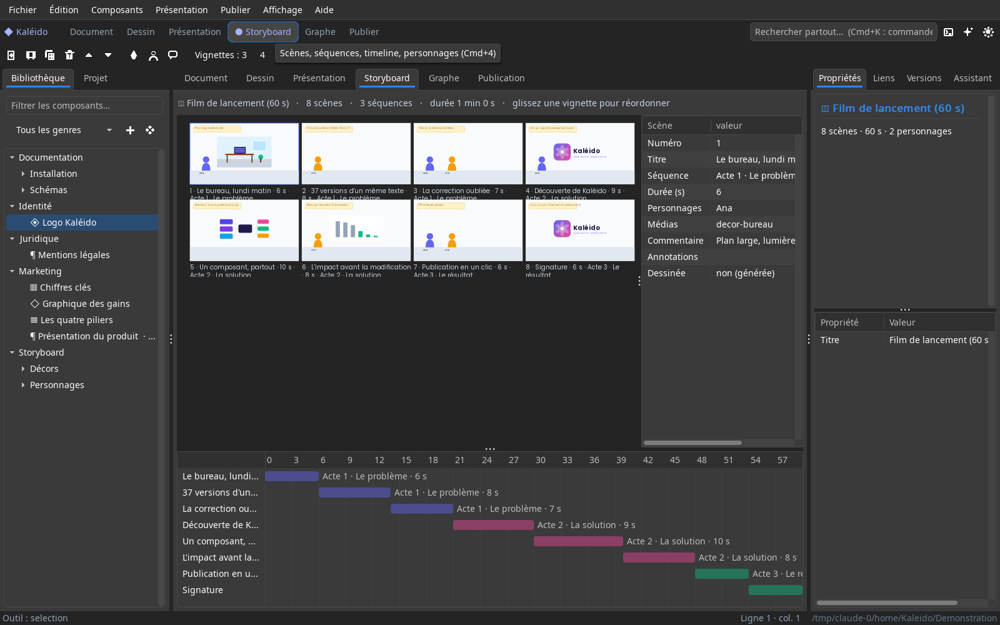
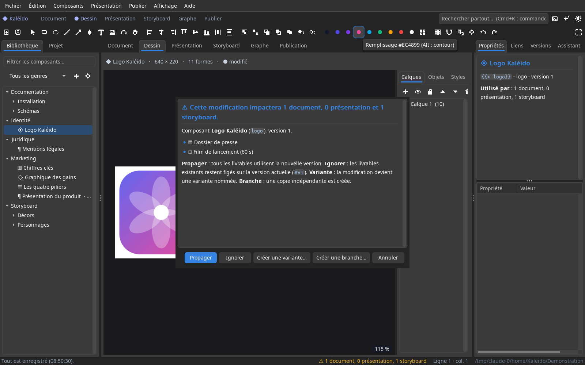
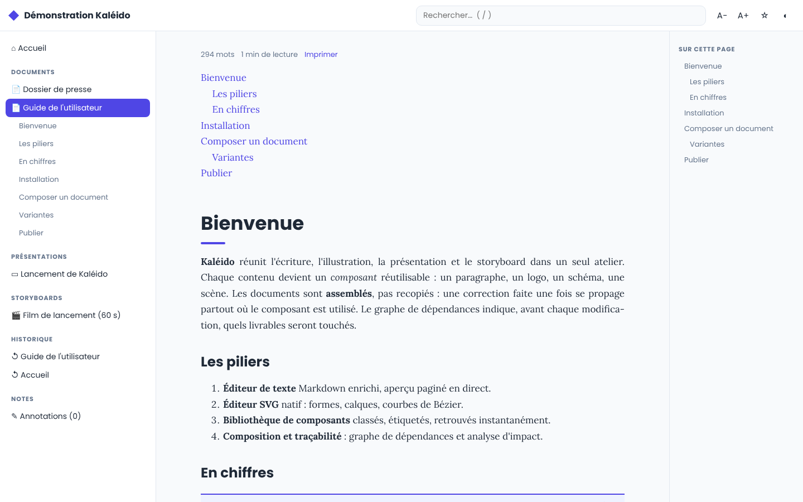

[[toc]]

# Vision et principes {#vision}

Kaléido réunit dans un seul atelier ce que l'on fait aujourd'hui avec cinq outils : l'éditeur de documents, l'éditeur d'illustrations, le logiciel de présentation, l'outil de storyboard et le gestionnaire de contenus réutilisables. Sa différence ne tient pas à la somme des fonctions mais à **un principe** : *rien n'est recopié*. Chaque paragraphe, logo, schéma, diapositive ou scène est un **composant**[[i:composant]] ; les livrables sont des **assemblages** de références, recomposés à chaque aperçu et à chaque publication. Une correction faite une fois se propage partout, et l'application sait toujours *qui utilise quoi*.

| Principe | Conséquence dans l'application |
|:--|:--|
| Une seule source par contenu | `{{> id}}` au lieu du copier-coller ; propagation contrôlée |
| Traçabilité[[i:traçabilité]] | graphe de dépendances ; impact affiché avant toute modification |
| Ce que l'on voit est ce que l'on publie | un seul moteur de mise en page pour l'aperçu, le SVG et le PDF |
| Formats ouverts | Markdown, SVG standard, JSON lisible, DuckDB, HTML sans dépendance |
| Productivité | palette universelle (Cmd+K), raccourcis, ruban contextuel, peu de clics |

> [!NOTE] Périmètre de cette version
> Le cahier décrit l'application livrée dans `exemples/kaleido` : tout ce qui y est présenté est implémenté et testé. Les quelques limites connues sont signalées dans le chapitre [[ref:limites]].

# 1. Architecture du logiciel {#architecture}

Kaléido est un programme **Lexis+** (≈ 7 200 lignes réparties en 17 modules) qui s'appuie sur des **paquets natifs** du runtime wdlexis+ pour les traitements lourds. La règle de partage est simple : *la logique de l'application est en Lexis+, les moteurs sont natifs*.

{largeur=100%}

| Couche | Rôle | Réalisation |
|:--|:--|:--|
| Application | espaces de travail, composition, graphe, variantes, publication, extensions | modules `.prg` (Lexis+) |
| Interface | fenêtres, rubans, arbres, grilles, éditeur de code, diagrammes, Gantt | paquet `interface` (wdgui, SDL3) |
| Toile vectorielle | édition directe de SVG, planches, lecture plein écran | `ui.toile` (wdgui/vcanvas, vscene) |
| Publication | mise en page Markdown → pages, PDF vectoriel, HTML, vectorisation | paquet `publication` (vlayout, vpdf, mdhtml, vtrace) |
| Données | index de recherche et graphe des usages | DuckDB intégré (`.kaleido/index.duckdb`) |
| Intelligence | modèles locaux GGUF | paquet `llm` (facultatif) |
| Lecteur web | site autonome HTML, CSS, JS, SVG | `ressources/lecteur.*` |

## Moteurs natifs ajoutés au runtime

- **vscene** : modèle de scène vectorielle (rectangles, ellipses, lignes, chemins de Bézier, textes en boîte, images, SVG imbriqués), lecture et écriture SVG, rendu anticrénelé (couverture exacte, règles non nul et pair-impair, dégradés, pointillés, flèches, ombres), texte TrueType.
- **vcanvas** : la toile — outils, poignées, magnétisme (grille, guides intelligents), calques, groupes, plume Bézier, nœuds, annulation, planches de pages (galerie, plateau), lecture.
- **vlayout** : typographie et pagination du Markdown enrichi (veuves et orphelines, tableaux à en-tête répété, figures, encadrés, sommaire, index, renvois).
- **vpdf** : PDF vectoriel avec polices TrueType incorporées en sous-ensemble, signets, liens, balisage d'accessibilité.
- **vtrace** : importation (PNG, JPEG, GIF, BMP, WEBP, PDF) et vectorisation ; opérations booléennes.

# 2. Modèle objet {#modele-objet}

Lexis+ n'a pas de classes au sens strict : les objets sont des **tables** dont les champs sont fixés par convention, et les **procédures** d'un module jouent le rôle des méthodes. Le modèle ci-dessous est celui des fichiers et de la mémoire.

| Objet | Champs principaux | Portée |
|:--|:--|:--|
| Projet `PROJ` | dossier, titre, auteur, variables, variantes, gabarit, cree | global |
| Composant | id, titre, genre, ext, dossier, collections, categorie, tags, motscles, description, auteur, version, variantes, branche_de, cree, modifie | `COMPOSANTS[id]` |
| Document | nom, titre, chemin, meta (titre, variante, gabarit) | `DOCS` |
| Présentation | nom, titre, theme, diapositives | `PRES` |
| Diapositive | id, section, disposition, titre, soustitre, texte, medias, notes, transition, duree, libre, svg | dans la présentation |
| Storyboard | nom, titre, colonnes, personnages, scenes | `SB` |
| Scène | id, titre, sequence, duree, personnages, medias, commentaire, annotations, dessinee, svg | dans le storyboard |
| Référence | id, variante, version | issue de `{{> id@var#vN}}` ou `data-composant` |
| Utilisation | source_genre, source_id, cible, variante, version | table DuckDB |
| Impact | documents, presentations, storyboards, composants, total | calculé |
| Commande | id, libelle, categorie, raccourci, proc | `COMMANDES` |
| Extension | genre, nom, libelle, procedure | `EXT_REG` |

**Genres de composants** : texte, paragraphe, liste, chapitre, page, section, tableau (contenu Markdown) ; illustration, logo, schéma, graphique, diapositive, scène (SVG) ; image, photo (bitmap).

# 3. Structure des « classes » Lexis+ {#classes}

Chaque module regroupe les procédures d'un objet, préfixées pour être lisibles et éviter les collisions (en Lexis+, un nom de procédure est unique dans le programme).

| Module | « Classe » | Méthodes représentatives |
|:--|:--|:--|
| projet.prg | Projet, Composant, Livrable, Index | `OUVRIR_PROJET`, `ENREGISTRER_COMPOSANT`, `CONTENU_COMPOSANT`, `VERSIONS`, `REINDEXER`, `CHERCHER_COMPOSANTS` |
| composition.prg | Compositeur | `COMPOSER`, `RESOUDRE`, `ENTETE`, `REFERENCES`, `COMPOSER_DOCUMENT` |
| graphe.prg | Graphe, Impact | `IMPACT`, `UTILISATIONS`, `DEMANDER_IMPACT`, `IMPACT_APPLIQUER`, `FIGER_REFERENCES`, `GRAPHE_IMPACT` |
| variantes.prg | Variante, Version, Branche | `CREER_VARIANTE_DIALOGUE`, `CREER_BRANCHE`, `VAR_PROMOUVOIR`, `VERS_RESTAURER`, `DIFF_MD` |
| texte.prg | Éditeur de document | `OUVRIR_DOCUMENT`, `APERCU_MAINTENANT`, `DOC_EXTRAIRE_COMPOSANT`, `MODELES` |
| dessin.prg | Éditeur SVG | `DESSIN_CHARGER`, `OUTIL_ACTIVER`, `BOOLEEN`, `DESSIN_SYMBOLE`, `CALQUES_RAFRAICHIR` |
| presentation.prg | Présentation, Diapositive, Thème | `DIAPO_SVG`, `PRES_REGENERER_TOUT`, `PRES_LANCER`, `PRES_TELEPROMPTEUR` |
| storyboard.prg | Storyboard, Scène | `SCENE_SVG`, `SB_RAFRAICHIR`, `SB_DEPLACE`, `SB_LIRE`, `SB_PDF` |
| publication.prg | Publication | `PUBLIER_DOCUMENT`, `PUBLIER_WEB`, `WEB_SVG_AUTONOME` |
| ia.prg | Assistant | `IA_TACHE`, `RESUME_EXTRACTIF`, `SIMILARITE`, `DOUBLONS_MD`, `COHERENCE_MD` |
| extensions.prg | Extension | `CHARGER_EXTENSIONS`, `KALEIDO_ENREGISTRER` |
| commandes.prg | Commande, Palette | `COMMANDE`, `PALETTE`, `QUICKPICK`, `EDITER_TEXTE` |

# 4. Organisation des modules {#modules}

```text
exemples/kaleido/
  principal.prg      fenêtre, espaces, rubans, inspecteur, raccourcis, réglages
  outils.prg         JSON lisible, textes, requêtes DuckDB, listes, journal
  projet.prg         projet, composants, livrables, index, historique
  composition.prg    composition, variables, macros, références
  bibliotheque.prg   arborescence, recherche, fiche, propriétés
  texte.prg          éditeur Markdown, aperçu paginé, extraits, modèles, gabarit
  dessin.prg         éditeur SVG, calques, objets, styles, symboles, booléens
  vectorisation.prg  importation et vectorisation
  presentation.prg   diapositives, thèmes, conférence, répétition, téléprompteur
  storyboard.prg     plateau, timeline, scènes, personnages, animatique, planches
  graphe.prg         impact, vues globale / descendante / ascendante, décision
  variantes.prg      variantes, versions, branches, comparaison
  publication.prg    PDF, site web, exports
  ia.prg             assistant (modèle local ou méthodes intégrées)
  extensions.prg     extensions (plugins)
  commandes.prg      registre, palette, menus, saisie multiligne
  demo.prg           projet de démonstration
  plugins/           extensions livrées (statistiques.prg)
  ressources/        index.html, lecteur.js, lecteur.css, lecteur.prg
```

Le runtime charge tous les `.prg` du dossier : un module n'a pas d'instruction en tête, seulement des procédures. Les dépendances entre modules sont des appels de procédures ; l'état partagé est réduit à quelques globales (`PROJ`, `COMPOSANTS`, `DOCS`, `PRES`, `SB`, `SEL`, `ESPACE`, `COMMANDES`, `MACROS`).

# 5. Format interne des documents {#format-documents}

Un document est un fichier **Markdown enrichi** (`documents/<nom>.md`) accompagné d'un fichier de métadonnées (`documents/<nom>.json` : titre, variante, réglages du gabarit). L'en-tête facultatif déclare des variables :

```markdown
---
titre: Guide de l'utilisateur
soustitre: Concevoir avec {{produit}}
auteur: Studio Lumen
---
{{toc}}
# Bienvenue
{{> presentation-produit}}
```

| Syntaxe | Effet |
|:--|:--|
| `{{> id}}` · `{{> id@client}}` · `{{> id#v3}}` | composant, variante, version figée |
| `{{variable}}` | variable du document, de la variante active ou du projet |
| `{{date}}` `{{heure}}` `{{projet}}` `{{auteur}}` | macros intégrées |
| `{{toc}}` `{{index}}` `{{saut}}` | sommaire, index alphabétique, saut de page |
| `{{index:terme}}` `{{ref:ancre}}` | entrée d'index invisible, renvoi « p. 12 » cliquable |
| `{{macro argument}}` | macro d'une extension |
| `# Titre {#ancre}` | ancre explicite (sinon dérivée du titre) |
| `> [!TIP] Titre` | encadré : NOTE, TIP, WARNING, IMPORTANT, CAUTION |
| `{largeur=60%}` | figure numérotée |

Le code (blocs délimités par trois accents graves et segments entre accents graves) reste littéral : on peut y montrer la syntaxe sans l'exécuter. Les **présentations** et **storyboards** sont des fichiers JSON lisibles dont chaque diapositive ou scène pointe vers un SVG standard (`presentations/<nom>/<id>.svg`).

# 6. Format de stockage des composants {#format-composants}

```text
composants/<id>.json              métadonnées (JSON lisible, clefs en minuscules)
composants/<id>.<md|svg|png>      contenu, version standard
composants/<id>@<variante>.<ext>  variantes (client, produit, marketing…)
.kaleido/historique/<id>/vN.<ext> versions précédentes
.kaleido/corbeille/               composants supprimés (récupérables)
.kaleido/index.duckdb             index reconstructible
```

```json
{
  "id": "presentation-produit",
  "titre": "Présentation du produit",
  "genre": "texte",
  "ext": "md",
  "dossier": "Marketing",
  "collections": ["Lancement"],
  "tags": ["produit", "accroche"],
  "variantes": ["client", "marketing"],
  "version": 1,
  "modifie": "2026-11-07 08:47:00"
}
```

Le dossier `Marketing/Logos` donne l'arborescence ; collections, catégorie, étiquettes et mots-clés alimentent la recherche. Les fichiers restent lisibles et versionnables (Git), l'index DuckDB pouvant toujours être reconstruit (`Reconstruire l'index`).

# 7. Gestion du graphe de dépendances {#graphe}

À chaque enregistrement, les références d'une source sont extraites (`{{> …}}`, images `composants/…`, attributs `data-composant` des SVG, médias des scènes) et écrites dans la table `utilisations`. L'**impact** d'un composant est le parcours en largeur des sources qui l'utilisent, en traversant les composants intermédiaires (un paragraphe inclus dans un chapitre inclus dans un document).

Avant d'enregistrer un composant partagé, Kaléido affiche l'impact et la liste des livrables concernés : « Cette modification impactera 1 document, 0 présentation et 1 storyboard. » L'utilisateur choisit :

| Choix | Effet |
|:--|:--|
| Propager | nouvelle version ; tous les usages sont recomposés |
| Ignorer | les usages existants sont figés sur la version courante (`#vN`, fichier d'historique) ; la nouvelle version ne vaut que pour les futurs usages |
| Créer une variante | la modification devient `id@nom` ; l'original est intact |
| Créer une branche | copie indépendante (`branche_de`) ; l'original est intact |

L'espace **Graphe** propose trois vues : globale (tout le projet), impact (descendante) et ascendante (ce qu'un élément utilise), plus les composants orphelins et les références cassées. Double-cliquer un nœud ouvre l'élément dans son éditeur.

, documents (indigo), présentations (rose), storyboards (ambre)"){largeur=100%}

# 8. Interface utilisateur {#interface}

L'écran suit la logique de WDLexis et d'Atlas SQL : **tout est visible, rien n'est caché derrière plus de deux clics**.

- **En-tête** : les six espaces (Document, Dessin, Présentation, Storyboard, Graphe, Publier ; Cmd+1 à Cmd+6), la recherche universelle, la palette, l'assistant, le thème.
- **Ruban contextuel** : ses outils dépendent de l'espace et de la sélection (un texte choisi dans le dessin remplace les outils de forme par ceux du texte ; la présentation ajoute ceux du dessin). Icônes vectorielles, infobulles avec raccourcis.
- **Bibliothèque** (gauche) : arborescence, filtre instantané, genre ; onglet Projet (documents, présentations, storyboards).
- **Espace central** : l'éditeur du moment.
- **Inspecteur** (droite) : Propriétés (fiche et grille modifiable), Liens (utilisations et dépendances), Versions (variantes, historique, comparaison), Assistant.
- **Barre d'état** : messages, impact, position, dossier du projet.

Les séparateurs se déplacent et leur position est mémorisée ; le thème clair ou sombre aussi. La **palette** (Cmd+K) cherche dans les commandes, les composants, les documents, leurs titres, les présentations et les storyboards.

# 9. Maquettes des écrans principaux {#maquettes}

Les maquettes sont des captures de l'application réelle (projet de démonstration).

{largeur=100%}

{largeur=100%}

{largeur=100%}

{largeur=100%}

{largeur=100%}

{largeur=100%}

# 10. Workflows {#workflows}

## Écrire un document à partir de composants

1. Cmd+1, **Nouveau document**, choix d'un modèle (rapport, manuel, livre, documentation logicielle, dossier de presse, formation).
2. Écrire en Markdown ; **Composant** (ou la complétion) insère `{{> id}}` ; **Variable** insère `{{…}}`.
3. Un passage déjà rédigé devient réutilisable : le sélectionner puis **Extraire** — il est remplacé par sa référence.
4. L'aperçu se met à jour en direct ; un double-clic sur une page amène l'éditeur au titre correspondant.
5. Cmd+P publie le PDF.

## Modifier un composant partagé

1. Double-clic sur le composant dans la bibliothèque : il s'ouvre dans l'éditeur adapté (texte ou SVG).
2. Cmd+S : Kaléido calcule l'impact et propose propager, ignorer, variante ou branche.
3. Les diapositives et scènes générées qui l'utilisent sont refaites ; les documents sont recomposés.

## Dessiner, importer, vectoriser

Outils au clavier (V, R, E, L, A, P, T, I, N, H) ; grille et guides intelligents ; alignements ; booléens ; **Symbole** transforme une sélection en composant lié. **Vectoriser** importe PNG, JPEG, WEBP, GIF, BMP ou une page de PDF, compare l'original et le SVG, puis range le résultat dans la bibliothèque ; **Optimiser** nettoie, simplifie et fusionne.

## Présenter

Diapositives générées par disposition et thème, retouchables à la main ; composants glissés depuis la bibliothèque ; F5 lance la conférence (plein écran et fenêtre du présentateur avec notes, diapositives suivantes, chronomètre) ; la répétition mémorise les durées réelles ; F8 ouvre le téléprompteur.

## Storyboarder

Plateau de vignettes (glisser pour réordonner), fiche de scène modifiable, timeline colorée par séquence, personnages, annotations, animatique, planches PDF.

# 11. API interne {#api}

| Appel | Rôle |
|:--|:--|
| `OUVRIR_PROJET(dossier)` | charge (ou crée) un projet, ouvre l'index |
| `COMPOSANT(id)` · `CONTENU_COMPOSANT(c, variante)` | accès aux composants |
| `ENREGISTRER_COMPOSANT(m, contenu, variante)` | crée ou met à jour ; historique ; index |
| `COMPOSER(texte, {variante})` | `{texte, problemes, utilises, variables}` |
| `COMPOSER_DOCUMENT(d, texte, variante)` | composition + gabarit prêt pour `pub.pdf` |
| `REFERENCES(texte, ext)` | références d'un Markdown ou d'un SVG |
| `IMPACT(id)` · `IMPACT_PHRASE(impact)` | impact transitif et phrase prête à afficher |
| `DEMANDER_IMPACT(c, contenu, variante, @rappel)` | décision avant modification |
| `CHERCHER_COMPOSANTS(q, genre)` | recherche instantanée (DuckDB) |
| `PUBLIER_DOCUMENT(d)` · `PUBLIER_WEB()` | publication |
| `COMMANDE(id, libelle, categorie, raccourci, @proc)` | nouvelle commande (palette, menus) |
| `QUICKPICK(titre, items, @proc)` · `EDITER_TEXTE(titre, aide, texte, @proc)` | dialogues réutilisables |
| `STATUT(message)` · `DOC_INSERER(texte)` · `INSERER_COMPOSANT(id)` | interaction |

Paquets natifs utilisés : `ui.toile` (chargersvg, svg, ajouter, modifier, forme, formes, selection, outil, aligner, ordre, grouper, booleen, calque, calques, grille, guide, annuler, retablir, chargerpages, png…) et `publication` (paginer, pdf, pdfsvg, html, titres, textebrut, importer, vectoriser, optimisersvg, tailleimage, mesurer, png). Ils sont documentés dans `DOCUMENTATION.md`.

# 12. Système d'extensions {#extensions}

Une extension est un fichier `.prg` placé dans `plugins/` (de l'application ou du projet). Son point d'entrée `EXTENSION_<NOM>()` déclare ce qu'elle apporte :

```lexis
procedure EXTENSION_STATISTIQUES
  KALEIDO_ENREGISTRER{genre = "commande", nom = "stats", libelle = "Statistiques du document", procedure = @STATS_DOCUMENT}
  KALEIDO_ENREGISTRER{genre = "macro", nom = "mots", procedure = @STATS_MACRO_MOTS}
  KALEIDO_ENREGISTRER{genre = "exportateur", nom = "txt", libelle = "Texte brut (.txt)", procedure = @STATS_EXPORT_TXT}
  KALEIDO_ENREGISTRER{genre = "verification", nom = "phrases", procedure = @STATS_PHRASES_LONGUES}
retourner
```

| Genre | Branchement |
|:--|:--|
| commande | palette et menus ; reçoit l'événement |
| macro | `{{nom argument}}` dans la composition ; reçoit (argument, contexte) |
| exportateur | « Exporter : … » ; reçoit (document, texte composé), renvoie le chemin |
| verification | ajoutée à « Vérifier la cohérence » ; renvoie du Markdown ou nul |

Les extensions d'un projet sont chargées par `lexis.charger` ; une erreur est journalisée sans bloquer l'application.

# 13. Stratégie de publication PDF {#pdf}

Le PDF est produit par **le moteur qui dessine l'aperçu** : le Markdown composé est mis en page en pages vectorielles (vlayout), puis écrit en PDF (vpdf). Aucune conversion intermédiaire, donc aucune surprise.

| Exigence | Réalisation |
|:--|:--|
| Standard, haute définition, écran | images sous-échantillonnées (2 400 px), d'origine, ou 1 200 px |
| Imprimable | repères de coupe, TrimBox et BleedBox |
| Interactif | liens externes, renvois internes, sommaire cliquable, index cliquable |
| Signets | titres de niveaux 1 à 3, hiérarchie conservée |
| Index, références croisées | `{{index:terme}}`, `{{ref:ancre}}`, deux passes de mise en page |
| Accessible | texte réel (ToUnicode), langue, titre affiché, balisage StructTreeRoot (H1…H6, P, LI, TH, TD, Figure avec texte de remplacement, Code ; décor en Artifact) |
| Gabarits, styles | format, marges, recto verso, polices, couleurs, numérotation, chapitres en nouvelle page, couverture |
| Foliotage, en-têtes | modèles « gauche\|centre\|droite » avec {titre}, {chapitre}, {page}, {pages} |
| Typographie | Poppins et Lora incorporées en sous-ensemble, justification, veuves et orphelines, titres jamais seuls en bas de page |

Les présentations deviennent un PDF d'une page vectorielle par diapositive (signets), les storyboards des planches de six scènes légendées.

# 14. Stratégie de publication Web {#web}

**Publier ▸ Site web** produit `publication/web/` : `index.html`, `lecteur.css`, `lecteur.js`, `contenu.js` (les données), `medias/` (SVG autonomes, images incorporées) et `polices/` (Poppins, Lora). Aucune dépendance externe : le site fonctionne ouvert directement (`file://`), sur un serveur, une tablette, un téléphone, ou dans la WebView de Lexis+ (lecteur intégré).

Le lecteur offre : navigation hiérarchique (documents et leurs titres, présentations, storyboards), recherche plein texte instantanée insensible aux accents, zoom du texte, mode documentation (sommaire dynamique qui suit la lecture), mode présentation (plein écran, transitions, notes, gestes de balayage), mode storyboard (timeline, animatique), liens internes, annotations sur le texte sélectionné, favoris, historique, thème clair ou sombre, impression.

# 15. Cahier technique de réalisation {#realisation}

## Prérequis et lancement

```sh
wdlexisrt exemples/kaleido/principal.prg [dossier_du_projet]
```

Au premier lancement, un projet de démonstration est créé dans `~/Kaleido/Demonstration` (11 composants avec variantes et versions, 2 documents, 1 présentation, 1 storyboard). Les réglages sont dans `~/.kaleido_reglages.json`.

## Choix techniques

- **Rendu** : la toile rastérise la scène dans une texture mise en cache ; pendant un glisser, la sélection est rendue à part (déplacement sans nouveau rendu complet).
- **Aperçu** : recalcul différé de 350 ms après la dernière frappe ; la mise en page d'un document de six pages prend une vingtaine de millisecondes.
- **Recherche** : index DuckDB (titres, étiquettes, texte brut) ; résultats classés par pertinence.
- **Mesure du texte** : métriques TrueType à 64 px pour des chasses non arrondies ; mêmes lignes de base à l'écran et dans le PDF.
- **Robustesse** : JSON lisibles, corbeille, historique de chaque version, journal `.kaleido/journal.txt`, index reconstructible.

## Tests réalisés

| Domaine | Vérification |
|:--|:--|
| Toile | création, déplacement, annulation, saisie de texte, magnétisme, calques |
| Composition | composants imbriqués, variantes, versions figées, variables, macros, cycles, code littéral |
| Impact | dialogue, propagation (version 2), historique, recomposition des livrables |
| PDF | 6 pages, signets hiérarchiques, sommaire et index justes, polices incorporées, 57 ms |
| Web | Chromium bureau et iPhone 13 : navigation, recherche, présentation, storyboard, sans erreur JavaScript |
| Storyboard | glisser-déposer d'une vignette (1 → 3), timeline à jour |
| Présentation | édition du contenu, régénération, conférence et fenêtre du présentateur |

## Limites connues {#limites}

- Les **animations** de diapositives sont les transitions (fondu, glissement, zoom) ; il n'y a pas encore d'animation par objet ni de piste audio synchronisée.
- La **vectorisation** est faite pour les logos, schémas et illustrations à aplats ; une photographie donne un SVG lourd.
- Les **booléens** sont calculés sur des masques fins (1 400 px) puis revectorisés : le résultat est un chemin courbe propre, non une intersection géométrique exacte.
- L'**assistant** génère, reformule et traduit avec un modèle GGUF local ; sans modèle, il propose les méthodes intégrées (résumé extractif, recherche, schéma SVG, doublons, cohérence).
- Le **WEBP** demande la bibliothèque SDL3_image (livrée sous macOS).

[[saut]]

[[index]]
